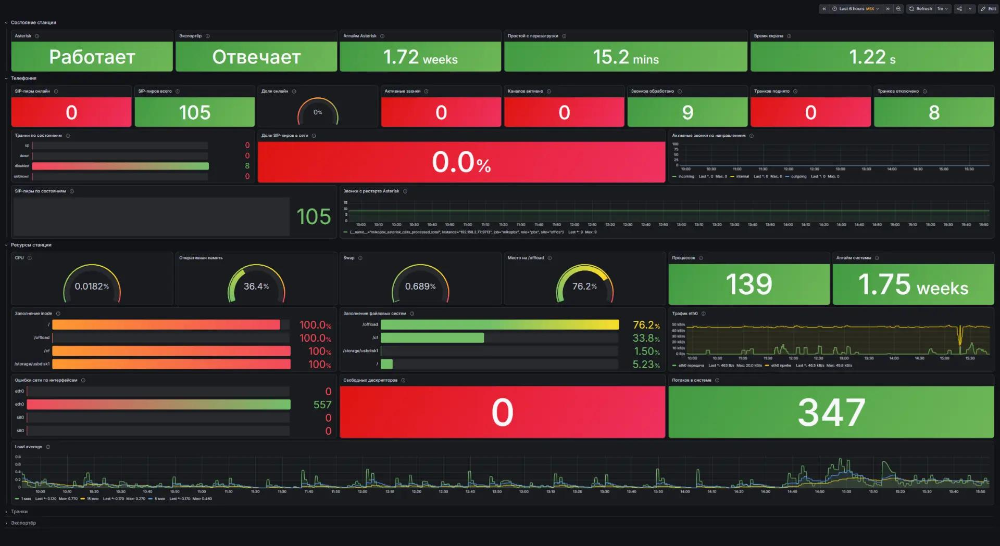
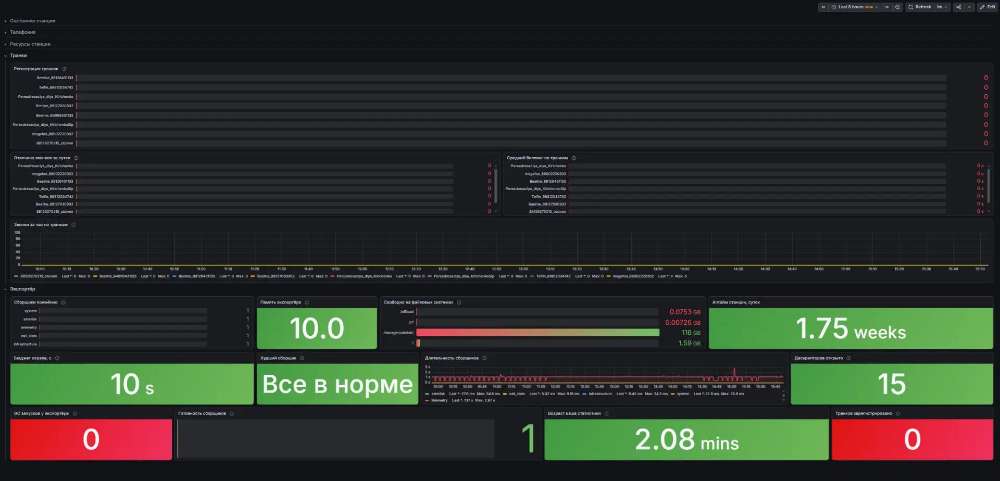
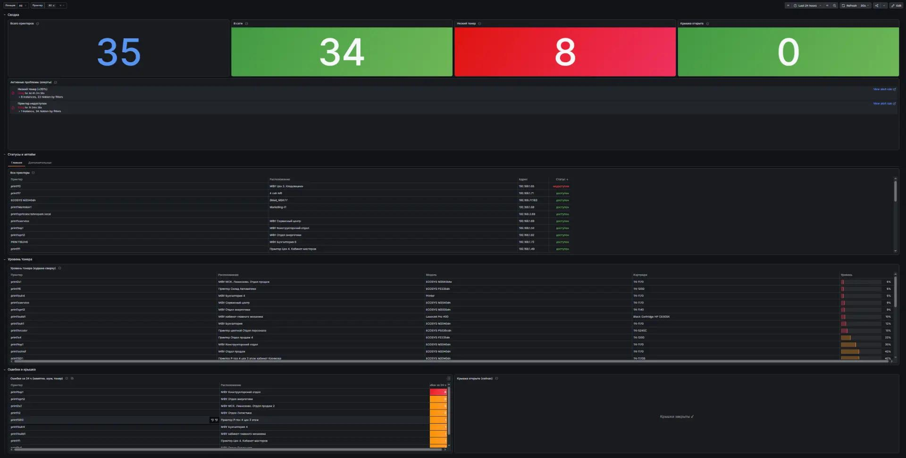
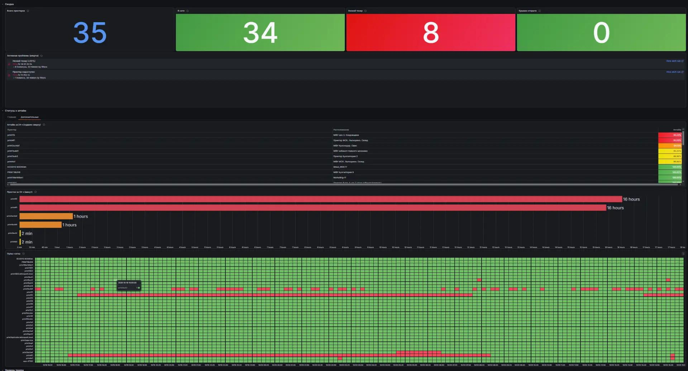
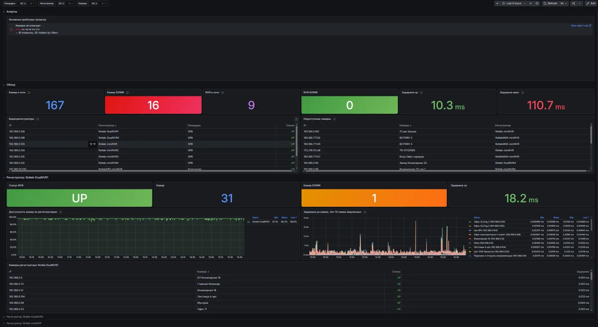

# Grafana dashboards

Экспорт дашбордов Grafana с тестового стенда мониторинга (Grafana 13.2.3) и
сопроводительная документация по каждому дашборду: состав панелей, переменные,
на что смотреть в первую очередь, известные ловушки.

[](https://github.com/kutyassistent-ops/grafana-dashboards/actions/workflows/ci.yml)

| Дашборд | Classic UID | Панелей | Строк | Переменные | Период по умолчанию | Документация |
|---|---|---|---|---|---|---|
| MikoPBX — АТС | `mikopbx-pbx` | 48 | 5 | — | 6 часов | [MikoPBX.md](MikoPBX/MikoPBX.md) |
| Принтеры | `aprj7f` | 12 | 6 | `loc`, `prt` | 24 часа | [Принтеры.md](Принтеры/Принтеры.md) |
| CCTV — камеры и видеорегистраторы | `cctv-cameras` | 16 | 3 | `site`, `nvr`, `location` | 6 часов | [CCTV.md](CCTV/CCTV.md) |

---

## Скриншоты

### MikoPBX — АТС (48 панелей)

Состояние станции, телефония, ресурсы, транки и сам экспортёр.



<details>
<summary>Транки и экспортёр</summary>



</details>

### Принтеры (12 панелей)

Доступность по SNMP, расходники, крышки, простои за сутки.



<details>
<summary>Простои и пульс-сетка</summary>



</details>

### CCTV (16 панелей)

Доступность камер и видеорегистраторов по ICMP с разбивкой по площадкам.



---

## Состав репозитория

```
grafana-dashboards/
├── MikoPBX/
│   ├── MikoPBX — АТС.json                            экспорт дашборда
│   ├── MikoPBX.md                                     документация
│   ├── dashboard-ats.jpg
│   └── dashboard-trunks-exporter.jpg
├── Принтеры/
│   ├── Принтеры.json
│   ├── Принтеры.md
│   ├── dashboard-overview.jpg
│   └── dashboard-downtime.jpg
├── CCTV/
│   ├── CCTV - камеры и видеорегистраторы.json
│   ├── CCTV.md
│   └── dashboard-cameras.jpg
├── tools/
│   └── validate_dashboards.py                        проверка дашбордов
└── .github/workflows/ci.yml                          прогон проверки
```

Файлы `.json` — выгрузки из Grafana, `.md` — документация по дашбордам,
`.jpg` — скриншоты.

### Проверка дашбордов

В репозитории есть валидатор: он разбирает каждый JSON, проверяет, что это
валидный ресурс Grafana, и печатает сводку.

```bash
python tools/validate_dashboards.py
```

```
UID                   Заголовок                           Панелей  Строк  Перем.
----------------------------------------------------------------------------------
mikopbx-pbx           MikoPBX — АТС                              48      5      0
cctv-cameras          CCTV - камеры и видеорегистраторы           16      3      3
aprj7f                Принтеры                                    12      6      2
----------------------------------------------------------------------------------
Проверено файлов: 3
Все дашборды валидны
```

Тот же валидатор прогоняется в CI на каждом пуше.

---

## Формат файлов

Это **не** классический экспорт дашборда, а ресурс Grafana в формате
resource API (`apiVersion: dashboard.grafana.app/v2`, `kind: Dashboard`).
Такие файлы кладутся в `/var/lib/grafana/dashboards/` и подхватываются
provisioning'ом — на стенде так и было:

```
/var/lib/grafana/dashboards/Телефония/mikopbx-pbx.json
/var/lib/grafana/dashboards/Принтеры алерты/aprj7f.json
/var/lib/grafana/dashboards/CCTV и алерты/cctv-cameras.json
```

Что где лежит внутри:

| Путь | Что |
|---|---|
| `metadata.name` | classic UID дашборда (`mikopbx-pbx`, `aprj7f`, `cctv-cameras`) |
| `metadata.uid` | UID ресурса (новый идентификатор Grafana 13) |
| `metadata.annotations['grafana.app/sourcePath']` | путь к файлу на сервере |
| `spec.elements[0]` | панели: карта `panel-<id>` → панель |
| `spec.layout` | строки (ряды) дашборда |
| `spec.variables` | переменные (`loc`, `prt`, `site`, `nvr`, `location`) |
| `spec.timeSettings` | период по умолчанию и автообновление |
| `spec.description` | описание дашборда |

### Как развернуть

**Provisioning (рекомендуется).** Положите файл в каталог дашбордов Grafana
и перезапустите:

```bash
# путь к каталогу зависит от способа установки Grafana
cp "MikoPBX/MikoPBX — АТС 192.168.2.77-1792414232750.json" \
   /var/lib/grafana/dashboards/Телефония/mikopbx-pbx.json

systemctl restart grafana-server
```

**Через API.** Для Grafana 12+ ресурс создаётся ресурсным API:

```bash
curl -X POST http://<grafana>:3000/api/v2/dashboards \
  -H "Authorization: Bearer $TOKEN" \
  -H "Content-Type: application/json" \
  --data-binary @dashboard.json
```

> [!warning] Формат v2 не импортируется через «Dashboards → Import»
> Классический JSON-экспорт с `dashboard` / `panels` / `rows` в этом файле
> отсутствует. Если нужен именно классический дашборд — экспортируйте его
> заново из UI (кнопка «Share → Export») и кладите в репозиторий рядом.

---

## Источники данных

| Дашборд | Задача Prometheus | Интервал |
|---|---|---|
| MikoPBX — АТС | `mikopbx` | 60 с |
| Принтеры | `printers_snmp` | — |
| CCTV | `cctv-cameras-ping` | — |

Метрики MikoPBX отдаёт модуль-экспортёр
[`MikoPBX_Prometheus`](https://github.com/kutyassistent-ops/MikoPBX_Prometheus)
(порт `9713`).

---

## Что смотреть в первую очередь

**MikoPBX:** панели «Экспортёр» и «Худший сборщик». Если экспортёр отвечает `0`,
все остальные панели показывают устаревшие данные, и это не выглядит как поломка
дашборда.

**Принтеры:** «Всего принтеров» против «В сети» — расхождение и есть `down`.

**CCTV:** «Камер DOWN» и «NVR DOWN». У камер недоступность меряется
`probe_success == 0`, а не `up == 0` — экспортирует их `blackbox_exporter`.

---

## Известные особенности

> [!warning] Панели алертов пустые
> Ни одно правило не привязано к дашборду (`dashboardUid` пуст), поэтому
> `alertlist` не покажет активные проблемы. Сами уведомления в Битрикс24
> доходят — алерты живут отдельно от дашбордов.

> [!warning] Метрика недоступности зависит от способа опроса
> Принтеры опрашиваются по SNMP → `up{job="printers_snmp"}`.
> Камеры — экспортёром `blackbox_exporter` → `probe_success == 0`.
> Путаница этих двух метрик — самая частая ошибка при разборе.

> [!info] Свёрнутые строки не грузятся
> Пока строка закрыта, её панели не запрашивают данные. Пустая свёрнутая
> строка не значит, что данных нет.

---

## Документация в формате Obsidian

Файлы `.md` выдернуты из личного Obsidian-хранилища, поэтому в них остались
вики-ссылки вида `[[Дашборды]]`, `[[grafana-alerts-current]]`. В GitHub они
выглядят как обычный текст — это нормально, они работают только внутри
Obsidian.

Документация описывает конкретный снимок стенда (16–19.10.2026): числа в
ней — состояние на тот момент. Актуальные значения всегда смотрите на
панелях, а не в тексте.

---

## Лицензия

MIT — см. [LICENSE](LICENSE).
